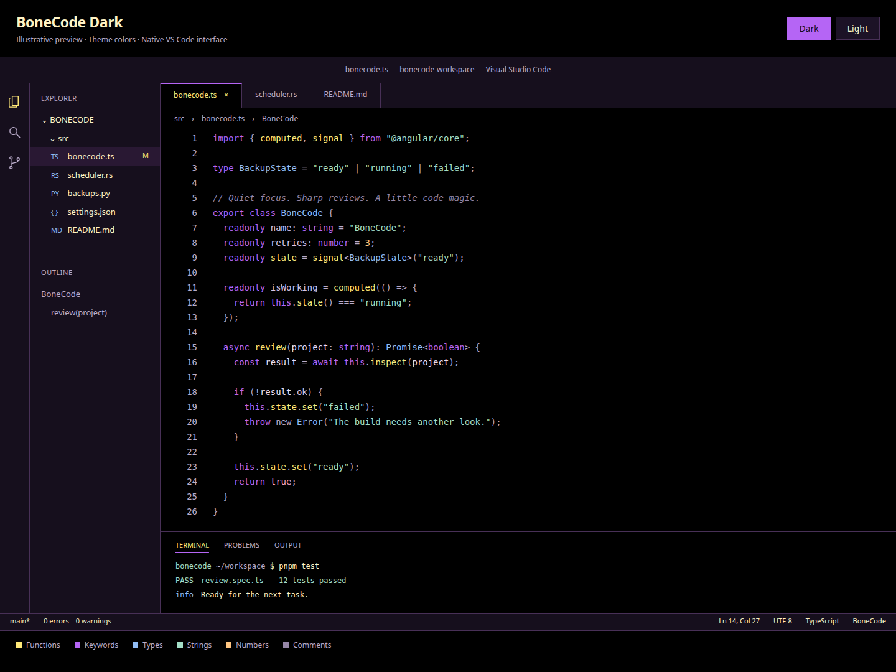
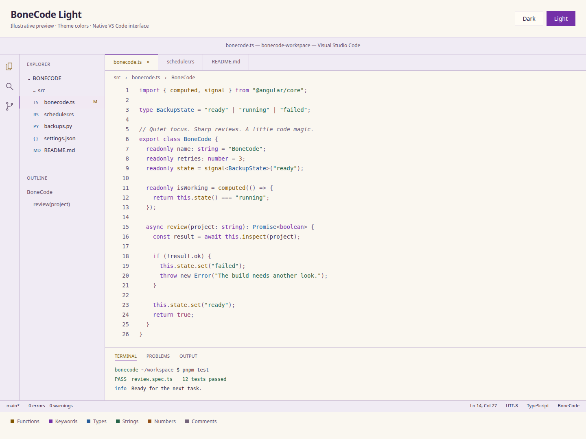

<p align="center">
  
</p>

<h1 align="center">BoneCode</h1>

<p align="center">
  <strong>A little dark magic for your editor.</strong><br>
  Pure black. Warm ivory. A palette with a personality.
</p>

<p align="center">
  Two color themes for Visual Studio Code, crafted by <strong>SK3L3T0R</strong>.<br>
  Inspired by BoneVim. Built with native VS Code theme colors.
</p>

<p align="center">
  <a href="#meet-your-next-theme">Explore the themes</a> ·
  <a href="#make-it-yours">Install BoneCode</a> ·
  <a href="#the-details-matter">What's included</a>
</p>



<p align="center"><sub>Illustrative HTML preview of the palette, not a VS Code screenshot. Fonts, icons, and layout depend on your editor settings.</sub></p>

## Meet your next theme

Your editor is where ideas become something real. Give it a look you want to come back to.

BoneCode pairs warm text with violet keywords, bone-yellow functions, blue types, and mint-green strings. Each color has a job, from the code you're reading to the changes you're reviewing.

### Dark, with a spark

**BoneCode Dark** puts your code on true `#000000` black. Deep eggplant panels frame the workspace, while warm highlights give functions, types, and strings a distinct presence.

For those who like their editor dark and their code full of character.

### Light, without losing its soul

**BoneCode Light** trades black for warm ivory and soft lavender. Deeper accents carry the same color roles into a brighter workspace, so switching appearances still feels like BoneCode.



*Both images are illustrative previews of the theme palette. Actual highlighting depends on your language's grammar and semantic tokens.*

## The details matter

- **A complete workspace palette.** Editor, panels, tabs, inputs, buttons, search, and selections share the same visual identity.
- **Color that carries meaning.** TextMate rules and semantic token colors distinguish functions, types, strings, and more.
- **Made for the whole workflow.** Git decorations, diffs, diagnostics, bracket highlights, and all 16 ANSI terminal colors are included.
- **Contrast checked in context.** The included validator checks text against editor, selection, search, occurrence-highlight, and composited diff backgrounds.
- **A simple theme extension.** No executable extension code or runtime dependencies. Install it, choose your theme, and keep coding.

## Make it yours

Works with **VS Code 1.85.0 and later**. One package includes both themes.

1. Get `bonecode-themes-1.0.1.vsix`. If you're starting from the source, use the packaging instructions below to create it.
2. Open **Extensions** (`Ctrl+Shift+X`) in VS Code, then choose **… → Install from VSIX…**.
3. Select the file, open **Preferences: Color Theme** (`Ctrl+K`, then `Ctrl+T`), and choose **BoneCode Dark** or **BoneCode Light**.

Prefer the terminal? Run this from the folder containing the VSIX:

```sh
code --install-extension ./bonecode-themes-1.0.1.vsix
```

Or select your installed theme in `settings.json`:

```jsonc
{
  "workbench.colorTheme": "BoneCode Dark"
}
```

<details>
<summary><strong>Switch with your system's appearance</strong></summary>

Let VS Code choose the right BoneCode variant when your system switches between dark and light. Merge these settings into your existing configuration:

```jsonc
{
  "window.autoDetectColorScheme": true,
  "workbench.preferredDarkColorTheme": "BoneCode Dark",
  "workbench.preferredLightColorTheme": "BoneCode Light"
}
```

</details>

<details>
<summary><strong>Tune the colors to your taste</strong></summary>

Use theme-specific overrides to make small adjustments without editing the extension:

```jsonc
{
  "workbench.colorCustomizations": {
    "[BoneCode Dark]": {
      "editorCursor.foreground": "#FFE878"
    },
    "[BoneCode Light]": {
      "editorCursor.foreground": "#815600"
    }
  }
}
```

For deeper changes, edit the JSON files in `themes/`. No JavaScript build is required.

If colors look unexpected, check your existing `workbench.colorCustomizations`, `editor.tokenColorCustomizations`, and `editor.semanticTokenColorCustomizations`. Use **Developer: Inspect Editor Tokens and Scopes** to see how a specific token is classified.

Fonts, text size, and file icons are configured separately. BoneCode uses native theme colors; window transparency, injected CSS, and glow effects are not part of the extension.

</details>

<details>
<summary><strong>Explore the palette</strong></summary>

| Color role | Dark | Light |
|---|---|---|
| Editor | `#000000` | `#FAF7F0` |
| Text | `#FFF3C4` | `#30243F` |
| Functions / bone accent | `#FFE878` | `#815600` |
| Keywords / violet | `#B565F5` | `#7431A8` |
| Types / blue | `#91BDF5` | `#265C99` |
| Strings / green | `#A3DEC7` | `#256349` |
| Comments | `#9586A6` | `#74647B` |

BoneVim provides the palette and syntax color roles. Glass UI inspired the separation between surfaces; Cyberpunk, the dark surfaces and accents; and Kaolin, the soft, light backgrounds. These are visual references; no code was copied from those themes.

</details>

<details>
<summary><strong>Validate and package from source</strong></summary>

From the project root, run the validator with Python 3.9 or later, then use Node.js and npm to build the VSIX:

```sh
python3 tests/validate.py
npx --yes @vscode/vsce package --no-dependencies --allow-missing-repository --no-rewrite-relative-links
```

This creates `bonecode-themes-1.0.1.vsix` for local installation. Relative image links are preserved for the source README. Before publishing to Marketplace, configure a public HTTPS repository or image base URL so the images can load there. Tests, design notes, and samples are excluded by `.vscodeignore`.

The publisher ID `SK3L3T0R` identifies the local package. It does not imply a registered Marketplace account or a published listing.

</details>

<details>
<summary><strong>References and inspiration</strong></summary>

- [VS Code color theme guide](https://code.visualstudio.com/api/extension-guides/color-theme)
- [Theme colors](https://code.visualstudio.com/api/references/theme-color)
- [Semantic tokens](https://code.visualstudio.com/api/language-extensions/semantic-highlight-guide)
- [Installing from a VSIX](https://code.visualstudio.com/docs/configure/extensions/extension-marketplace#_install-from-a-vsix)
- [Glass UI](https://github.com/AregGhazaryan/GlassUI-VScode)
- [Cyberpunk](https://github.com/prometheux-ar/cyberpunk)
- [Kaolin](https://github.com/zed-nait/kaolin-vscode-themes)

</details>

---

<p align="center">
  <strong>Quiet focus. A little code magic.</strong><br>
  Made by <strong>SK3L3T0R</strong> · <a href="LICENSE">MIT licensed</a>
</p>
